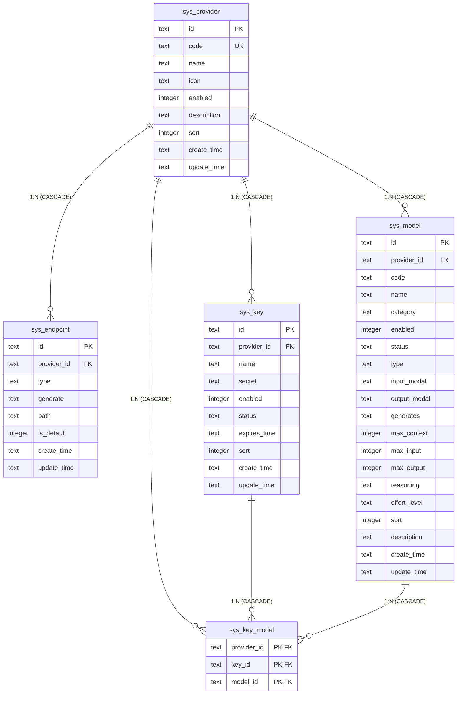

# AI Gate 数据库设计

## 概述

| 项 | 说明 |
|---|---|
| 数据库引擎 | SQLite（`@libsql/client` + `Drizzle ORM`，全异步/零原生编译依赖） |
| 数据库文件 | `server/data/ai-gate.db`（支持通过环境变量 `AI_GATE_DATA_DIR` 指定目录） |
| 连接策略 | 进程级单例（`server/src/db.ts`），启用 WAL 模式，`busy_timeout = 5000` |
| Schema 定义 | TypeScript 单源定义在 `server/src/schema/index.ts` |
| 迁移机制 | `drizzle-kit` 自动化管理（产物位于 `server/drizzle/`），服务启动时自动同步 |
| 命名约定 | 表名采用 `sys_` 前缀 + snake_case；字段名采用 snake_case |
| 时间规范 | `CURRENT_TIMESTAMP`（UTC，格式 `YYYY-MM-DD HH:MM:SS`），由数据库缺省自动维护 |

## 实体关系



## 数据表清单

| 表名 | 实体名称 | 说明 |
|---|---|---|
| `sys_provider` | 供应商 | 记录 AI 供应商基础元数据及全局配置 |
| `sys_endpoint` | 供应商端点 | 记录供应商网络接入点（基地址、模型列表拉取、生成类型路径） |
| `sys_key` | 供应商密钥 | 记录供应商关联的 API Key 凭证及有效状态 |
| `sys_model` | 供应商模型 | 记录供应商支持的模型参数、模态、上下文限额及能力特征 |
| `sys_key_model` | 密钥-模型关联 | 记录密钥与可用模型之间的多对多授权关系 |

---

## 1. sys_provider 供应商

存储 AI 供应商基础信息，`code` 用于对外模型标识前缀（如 `agnes/agnes-2.5-flash` 中的 `agnes`）。

### DDL

```sql
CREATE TABLE IF NOT EXISTS sys_provider (
  id TEXT PRIMARY KEY NOT NULL,
  code TEXT NOT NULL UNIQUE,
  name TEXT NOT NULL,
  icon TEXT NOT NULL DEFAULT '',
  enabled INTEGER NOT NULL DEFAULT 0,
  description TEXT NOT NULL DEFAULT '',
  sort INTEGER NOT NULL DEFAULT 0,
  create_time TEXT NOT NULL DEFAULT CURRENT_TIMESTAMP,
  update_time TEXT NOT NULL DEFAULT CURRENT_TIMESTAMP
);
```

### 字段说明

| 字段 | 类型 | 约束 / 默认值 | 说明 |
|---|---|---|---|
| `id` | TEXT | PRIMARY KEY | UUID 主键 |
| `code` | TEXT | NOT NULL UNIQUE | 供应商唯一编码，用于路由前缀与外部模型标识 |
| `name` | TEXT | NOT NULL | 供应商名称 |
| `icon` | TEXT NOT NULL DEFAULT `''` | 品牌图标标识 |
| `enabled` | INTEGER | NOT NULL DEFAULT 0 | 启用状态（0: 禁用, 1: 启用） |
| `description` | TEXT | NOT NULL DEFAULT `''` | 描述信息 |
| `sort` | INTEGER | NOT NULL DEFAULT 0 | 排序值，数值越小越靠前 |
| `create_time` | TEXT | NOT NULL DEFAULT CURRENT_TIMESTAMP | 创建时间（UTC） |
| `update_time` | TEXT | NOT NULL DEFAULT CURRENT_TIMESTAMP | 更新时间（UTC） |

### 索引

| 索引名称 | 索引列 | 类型 | 说明 |
|---|---|---|---|
| `sys_provider_code_unique` | `code` | UNIQUE | 供应商编码全局唯一 |

---

## 2. sys_endpoint 供应商端点

存储供应商的网络接入点，涵盖基础 URL（base）、模型列表拉取（models）及各生成端点（generate）路径映射。

### DDL

```sql
CREATE TABLE IF NOT EXISTS sys_endpoint (
  id TEXT PRIMARY KEY NOT NULL,
  provider_id TEXT NOT NULL REFERENCES sys_provider (id) ON DELETE CASCADE,
  type TEXT NOT NULL,
  generate TEXT NOT NULL DEFAULT '',
  path TEXT NOT NULL,
  is_default INTEGER NOT NULL DEFAULT 0,
  create_time TEXT NOT NULL DEFAULT CURRENT_TIMESTAMP,
  update_time TEXT NOT NULL DEFAULT CURRENT_TIMESTAMP
);

CREATE INDEX IF NOT EXISTS idx_endpoint_provider ON sys_endpoint (provider_id);
CREATE UNIQUE INDEX IF NOT EXISTS idx_endpoint_provider_type_generate ON sys_endpoint (provider_id, type, generate);
```

### 字段说明

| 字段 | 类型 | 约束 / 默认值 | 说明 |
|---|---|---|---|
| `id` | TEXT | PRIMARY KEY | UUID 主键 |
| `provider_id` | TEXT | NOT NULL REFERENCES `sys_provider(id)` ON DELETE CASCADE | 外键，关联供应商 ID |
| `type` | TEXT | NOT NULL | 端点类型：`base`（基地址）、`models`（模型列表地址）、`generate`（生成地址） |
| `generate` | TEXT | NOT NULL DEFAULT `''` | 生成类型标识（如 `Chat Completions`、`Responses`、`Messages`；base/models 类型为空） |
| `path` | TEXT | NOT NULL | 端点路径或完整 URL（如 `/v1/chat/completions`、`https://api.openai.com`） |
| `is_default` | INTEGER | NOT NULL DEFAULT 0 | 是否为默认端点（0: 否, 1: 是） |
| `create_time` | TEXT | NOT NULL DEFAULT CURRENT_TIMESTAMP | 创建时间（UTC） |
| `update_time` | TEXT | NOT NULL DEFAULT CURRENT_TIMESTAMP | 更新时间（UTC） |

### 索引与约束

| 索引名称 | 索引列 | 类型 | 说明 |
|---|---|---|---|
| `idx_endpoint_provider` | `provider_id` | 普通索引 | 加速供应商端点列表查询 |
| `idx_endpoint_provider_type_generate` | `provider_id, type, generate` | UNIQUE | 同一供应商下，base/models 端点各限一条；各 generate 类型的生成端点仅允许一条 |

---

## 3. sys_key 供应商密钥

存储供应商各个账户的 API 凭证及有效性、过期时间配置。

### DDL

```sql
CREATE TABLE IF NOT EXISTS sys_key (
  id TEXT PRIMARY KEY NOT NULL,
  provider_id TEXT NOT NULL REFERENCES sys_provider (id) ON DELETE CASCADE,
  name TEXT NOT NULL,
  secret TEXT NOT NULL,
  enabled INTEGER NOT NULL DEFAULT 0,
  status TEXT NOT NULL DEFAULT 'ACTIVE',
  expires_time TEXT,
  sort INTEGER NOT NULL DEFAULT 0,
  create_time TEXT NOT NULL DEFAULT CURRENT_TIMESTAMP,
  update_time TEXT NOT NULL DEFAULT CURRENT_TIMESTAMP
);

CREATE INDEX IF NOT EXISTS idx_key_provider ON sys_key (provider_id, sort);
```

### 字段说明

| 字段 | 类型 | 约束 / 默认值 | 说明 |
|---|---|---|---|
| `id` | TEXT | PRIMARY KEY | UUID 主键 |
| `provider_id` | TEXT | NOT NULL REFERENCES `sys_provider(id)` ON DELETE CASCADE | 外键，关联供应商 ID |
| `name` | TEXT | NOT NULL | 密钥名称或备注 |
| `secret` | TEXT | NOT NULL | 密钥凭证内容 |
| `enabled` | INTEGER | NOT NULL DEFAULT 0 | 启用状态（0: 禁用, 1: 启用） |
| `status` | TEXT | NOT NULL DEFAULT 'ACTIVE' | 密钥状态：`ACTIVE`（正常）、`INVALID`（已失效） |
| `expires_time` | TEXT | NULL | 过期时间（NULL 表示永久有效；格式 `YYYY-MM-DD HH:MM:SS`） |
| `sort` | INTEGER | NOT NULL DEFAULT 0 | 排序值，数值越小越靠前 |
| `create_time` | TEXT | NOT NULL DEFAULT CURRENT_TIMESTAMP | 创建时间（UTC） |
| `update_time` | TEXT | NOT NULL DEFAULT CURRENT_TIMESTAMP | 更新时间（UTC） |

### 索引

| 索引名称 | 索引列 | 类型 | 说明 |
|---|---|---|---|
| `idx_key_provider` | `provider_id, sort` | 普通复合索引 | 加速供应商密钥按排序值获取列表 |

---

## 4. sys_model 供应商模型

存储供应商下属的具体模型及其模态、上下文限额、推理支持程度等能力元数据。

### DDL

```sql
CREATE TABLE IF NOT EXISTS sys_model (
  id TEXT PRIMARY KEY NOT NULL,
  provider_id TEXT NOT NULL REFERENCES sys_provider (id) ON DELETE CASCADE,
  code TEXT NOT NULL,
  name TEXT NOT NULL DEFAULT '',
  category TEXT NOT NULL DEFAULT '',
  enabled INTEGER NOT NULL DEFAULT 0,
  status TEXT NOT NULL DEFAULT 'ACTIVE',
  type TEXT NOT NULL,
  input_modal TEXT NOT NULL DEFAULT '["text"]',
  output_modal TEXT NOT NULL DEFAULT '["text"]',
  generates TEXT NOT NULL DEFAULT '[]',
  max_context INTEGER NOT NULL DEFAULT 0,
  max_input INTEGER NOT NULL DEFAULT 0,
  max_output INTEGER NOT NULL DEFAULT 0,
  reasoning TEXT NOT NULL DEFAULT 'TOGGLE',
  effort_level TEXT NOT NULL DEFAULT '[]',
  sort INTEGER NOT NULL DEFAULT 0,
  description TEXT NOT NULL DEFAULT '',
  create_time TEXT NOT NULL DEFAULT CURRENT_TIMESTAMP,
  update_time TEXT NOT NULL DEFAULT CURRENT_TIMESTAMP,
  UNIQUE (provider_id, code)
);

CREATE INDEX IF NOT EXISTS idx_model_provider ON sys_model (provider_id, sort);
```

### 字段说明

| 字段 | 类型 | 约束 / 默认值 | 说明 |
|---|---|---|---|
| `id` | TEXT | PRIMARY KEY | UUID 主键 |
| `provider_id` | TEXT | NOT NULL REFERENCES `sys_provider(id)` ON DELETE CASCADE | 外键，关联供应商 ID |
| `code` | TEXT | NOT NULL | 模型标识（如 `gpt-4o`、`claude-3-5-sonnet-20241022`） |
| `name` | TEXT | NOT NULL DEFAULT `''` | 模型别名或展示名称 |
| `category` | TEXT | NOT NULL DEFAULT `''` | 模型分组/分类标签 |
| `enabled` | INTEGER | NOT NULL DEFAULT 0 | 启用状态（0: 禁用, 1: 启用） |
| `status` | TEXT | NOT NULL DEFAULT 'ACTIVE' | 模型状态：`ACTIVE`（正常）、`INVALID`（已失效） |
| `type` | TEXT | NOT NULL | 模型类别枚举：`GenText`、`GenImage`、`GenAudio`、`GenVideo`、`Embedding`、`Rerank` |
| `input_modal` | TEXT | NOT NULL DEFAULT `'["text"]'` | 输入模态列表，JSON 数组（如 `["text", "image"]`） |
| `output_modal` | TEXT | NOT NULL DEFAULT `'["text"]'` | 输出模态列表，JSON 数组（如 `["text"]`） |
| `generates` | TEXT | NOT NULL DEFAULT `'[]'` | 支持的生成类型列表，JSON 数组（如 `["Chat Completions"]`） |
| `max_context` | INTEGER | NOT NULL DEFAULT 0 | 最大上下文 Tokens |
| `max_input` | INTEGER | NOT NULL DEFAULT 0 | 最大输入 Tokens |
| `max_output` | INTEGER | NOT NULL DEFAULT 0 | 最大输出 Tokens |
| `reasoning` | TEXT | NOT NULL DEFAULT 'TOGGLE' | 思考/推理模式：`DISABLE`（不支持）、`ALWAYS`（强制）、`SWITCH`（开关）、`TOGGLE`（切换档位） |
| `effort_level` | TEXT | NOT NULL DEFAULT `'[]'` | 支持的推理程度选项，JSON 数组（如 `["none", "low", "medium", "high"]`） |
| `sort` | INTEGER | NOT NULL DEFAULT 0 | 排序值，数值越小越靠前 |
| `description` | TEXT | NOT NULL DEFAULT `''` | 模型说明与描述 |
| `create_time` | TEXT | NOT NULL DEFAULT CURRENT_TIMESTAMP | 创建时间（UTC） |
| `update_time` | TEXT | NOT NULL DEFAULT CURRENT_TIMESTAMP | 更新时间（UTC） |

### 索引与约束

| 索引名称 | 索引列 | 类型 | 说明 |
|---|---|---|---|
| `sys_model_provider_id_code_unique` | `provider_id, code` | UNIQUE | 同一供应商下的模型标识必须唯一 |
| `idx_model_provider` | `provider_id, sort` | 普通复合索引 | 加速供应商模型按排序值获取列表 |

---

## 5. sys_key_model 密钥-模型关联

记录 API 密钥与模型之间的可用性关联，支持多对多授权配置。

### DDL

```sql
CREATE TABLE IF NOT EXISTS sys_key_model (
  provider_id TEXT NOT NULL REFERENCES sys_provider (id) ON DELETE CASCADE,
  key_id TEXT NOT NULL REFERENCES sys_key (id) ON DELETE CASCADE,
  model_id TEXT NOT NULL REFERENCES sys_model (id) ON DELETE CASCADE,
  PRIMARY KEY (provider_id, key_id, model_id)
);

CREATE INDEX IF NOT EXISTS idx_key_model_key ON sys_key_model (key_id);
CREATE INDEX IF NOT EXISTS idx_key_model_model ON sys_key_model (model_id);
```

### 字段说明

| 字段 | 类型 | 约束 | 说明 |
|---|---|---|---|
| `provider_id` | TEXT | NOT NULL REFERENCES `sys_provider(id)` ON DELETE CASCADE | 外键，关联供应商 ID |
| `key_id` | TEXT | NOT NULL REFERENCES `sys_key(id)` ON DELETE CASCADE | 外键，关联密钥 ID |
| `model_id` | TEXT | NOT NULL REFERENCES `sys_model(id)` ON DELETE CASCADE | 外键，关联模型 ID |

### 索引与约束

| 索引名称 | 索引列 | 类型 | 说明 |
|---|---|---|---|
| PRIMARY KEY | `provider_id, key_id, model_id` | 复合主键 | 联合唯一，防止重复关联 |
| `idx_key_model_key` | `key_id` | 普通索引 | 加速按指定密钥查询可用模型列表 |
| `idx_key_model_model` | `model_id` | 普通索引 | 加速按指定模型反查绑定密钥列表 |

